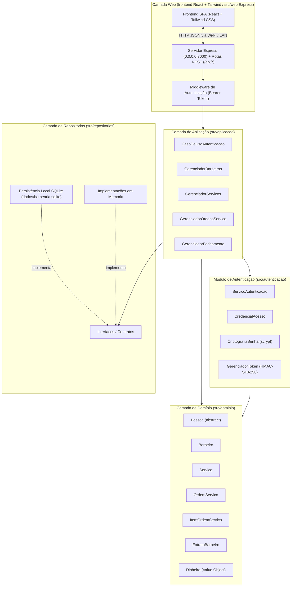
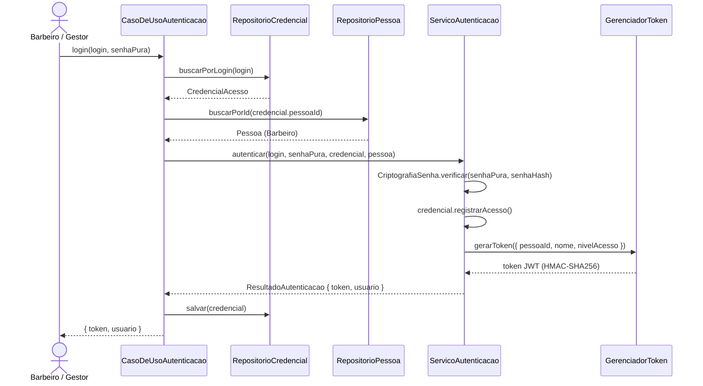
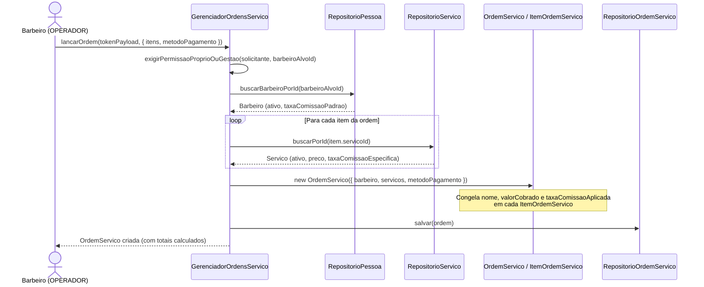
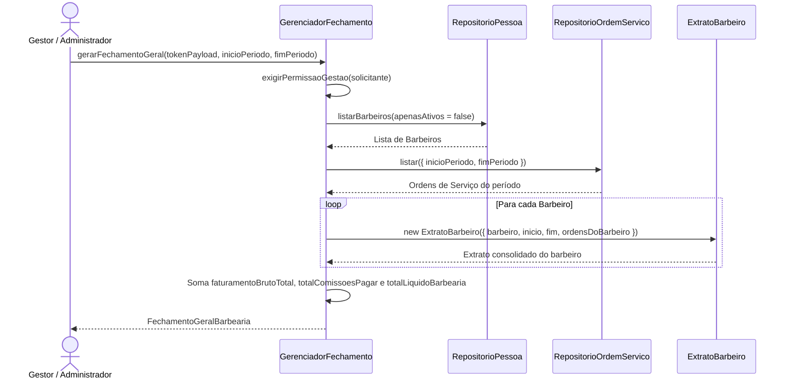

# 💈 BarberShop Manager

Sistema de gerenciamento de **Ordens de Serviço** e **Comissões Mensais** para barbearia, desenvolvido em **TypeScript** seguindo princípios de *Clean Architecture* e *Domain-Driven Design (DDD)*.

O objetivo central do sistema é permitir que cada barbeiro registre de forma rápida os serviços realizados a cada atendimento (simples ou combinados, como *Corte + Barba + Sobrancelha*) e que, ao final do mês, a gestão saiba com precisão e em tempo real quanto deve ser pago a cada profissional e qual foi o resultado líquido da barbearia.

---

## 🏛️ Visão Geral da Arquitetura

O projeto é dividido em camadas independentes e desacopladas, garantindo que as regras financeiras e de comissão não dependam de banco de dados ou frameworks externos:



---

## 🧩 Diagrama de Classes do Domínio e Autenticação

O diagrama abaixo representa as entidades de domínio, objetos de valor, enums e sua relação com o módulo de autenticação:

```mermaid
classDiagram
    direction TB

    class NivelAcesso {
        <<enumeration>>
        ADMINISTRADOR
        GESTOR
        OPERADOR
    }

    class MetodoPagamento {
        <<enumeration>>
        PIX
        CARTAO_CREDITO
        CARTAO_DEBITO
        DINHEIRO
    }

    class Dinheiro {
        <<Value Object>>
        +readonly valor: number
        +zero()$ Dinheiro
        +somar(outro: Dinheiro) Dinheiro
        +subtrair(outro: Dinheiro) Dinheiro
        +calcularPorcentagem(porcentagem: number) Dinheiro
        +igual(outro: Dinheiro) boolean
        +formatar() string
    }

    class Pessoa {
        <<abstract>>
        +readonly id: string
        +nome: string
        +email?: string
        +telefone?: string
        +nivelAcesso: NivelAcesso
        +ativo: boolean
        +readonly criadoEm: Date
        +ehAdministrador() boolean
        +podeGerenciarBarbearia() boolean
    }

    class Barbeiro {
        +taxaComissaoPadrao: number
    }

    class CredencialAcesso {
        +readonly id: string
        +readonly pessoaId: string
        +login: string
        -senhaHash: string
        +ativo: boolean
        +ultimoAcessoEm?: Date
        +readonly criadoEm: Date
        +atualizarSenhaHash(novoHash: string) void
        +registrarAcesso(data?: Date) void
    }

    class Servico {
        +readonly id: string
        +nome: string
        +preco: Dinheiro
        +taxaComissaoEspecifica?: number
        +ativo: boolean
    }

    class ItemOrdemServico {
        +readonly servicoId: string
        +readonly nomeServicoHistorico: string
        +readonly valorCobrado: Dinheiro
        +readonly taxaComissaoAplicada: number
        +valorComissaoBarbeiro: Dinheiro
        +valorBarbearia: Dinheiro
    }

    class OrdemServico {
        +readonly id: string
        +readonly barbeiroId: string
        +readonly itens: ReadonlyArray~ItemOrdemServico~
        +readonly metodoPagamento: MetodoPagamento
        +readonly realizadoEm: Date
        +readonly observacoes?: string
        +valorTotal: Dinheiro
        +valorTotalComissaoBarbeiro: Dinheiro
        +valorTotalBarbearia: Dinheiro
    }

    class ExtratoBarbeiro {
        +readonly barbeiroId: string
        +readonly nomeBarbeiro: string
        +readonly inicioPeriodo: Date
        +readonly fimPeriodo: Date
        +readonly ordens: ReadonlyArray~OrdemServico~
        +totalOrdens: number
        +totalServicosExecutados: number
        +faturamentoBruto: Dinheiro
        +totalComissaoBarbeiro: Dinheiro
        +totalBarbearia: Dinheiro
    }

    Pessoa <|-- Barbeiro : herda (futuro: Cliente)
    Pessoa --> NivelAcesso : possui
    CredencialAcesso ..> Pessoa : referencia (pessoaId)
    Servico *-- Dinheiro : preco
    OrdemServico *-- "1..*" ItemOrdemServico : contém
    OrdemServico --> Barbeiro : realizada por
    OrdemServico --> MetodoPagamento : paga via
    ItemOrdemServico --> Servico : congela dados de
    ItemOrdemServico *-- Dinheiro : valorCobrado
    ExtratoBarbeiro o-- "0..*" OrdemServico : consolida
```

---

## 🔄 Fluxos de Funcionamento (Diagramas de Sequência)

### 1. Fluxo de Login e Emissão de Token
A autenticação é desacoplada da entidade `Pessoa`. As senhas são protegidas com `scrypt` + *salt* aleatório, e a sessão utiliza tokens assinados com `HMAC-SHA256`:



### 2. Fluxo de Lançamento de Ordem de Serviço
Quando um barbeiro finaliza um atendimento, ele pode lançar **um ou múltiplos serviços** na mesma Ordem de Serviço. O sistema valida permissões e congela o preço e a porcentagem de comissão vigentes naquele instante:



### 3. Fluxo de Fechamento Mensal Geral
No final do mês, o Gestor ou Administrador solicita o fechamento do período e recebe o detalhamento por barbeiro e o consolidado geral da barbearia:



---

## 🔐 Matriz de Permissões (`NivelAcesso`)

As permissões são verificadas diretamente na camada de aplicação (`src/aplicacao/permissoes.ts`):

| Operação | `OPERADOR` (Barbeiro) | `GESTOR` | `ADMINISTRADOR` |
| :--- | :---: | :---: | :---: |
| Cadastrar Barbeiro (Operador / Gestor) | ❌ | ✅ | ✅ |
| Cadastrar outro Administrador | ❌ | ❌ | ✅ |
| Alterar Comissão / Ativar ou Inativar Barbeiro | ❌ | ✅ | ✅ |
| Cadastrar e Editar Serviços do Catálogo | ❌ | ✅ | ✅ |
| Listar Serviços Ativos | ✅ | ✅ | ✅ |
| Lançar Ordem de Serviço | ✅ *(Apenas para si mesmo)* | ✅ *(Qualquer barbeiro)* | ✅ *(Qualquer barbeiro)* |
| Consultar Extrato de Comissões Individual | ✅ *(Apenas o próprio)* | ✅ *(Qualquer barbeiro)* | ✅ *(Qualquer barbeiro)* |
| Gerar Fechamento Geral da Barbearia | ❌ | ✅ | ✅ |

---

## 💡 Regras de Negócio Importantes

1. **Objeto de Valor `Dinheiro`**:
   - Todo valor monetário é encapsulado na classe `Dinheiro`, que garante arredondamento de 2 casas decimais (`toFixed(2)`), impede valores negativos e expõe operações seguras (`somar`, `subtrair`, `calcularPorcentagem`, `formatar`).
2. **Precedência da Taxa de Comissão**:
   - Cada `Barbeiro` possui uma `taxaComissaoPadrao` (ex: `50%`).
   - Um `Servico` pode opcionalmente definir uma `taxaComissaoEspecifica` (ex: `60%`).
   - Ao lançar um item na Ordem de Serviço, vale a regra:
     $$\text{Taxa Aplicada} = \text{taxaComissaoEspecifica do Serviço} \ ?? \ \text{taxaComissaoPadrao do Barbeiro}$$
3. **Imutabilidade Histórica (`Snapshot`)**:
   - Quando uma `OrdemServico` é criada, cada `ItemOrdemServico` copia e congela o nome do serviço (`nomeServicoHistorico`), o valor pago (`valorCobrado`) e a porcentagem aplicada (`taxaComissaoAplicada`).
   - Assim, se o preço de um serviço ou a comissão de um barbeiro mudar no meio do mês, **nenhum lançamento passado é alterado**.
4. **Herança de `Pessoa`**:
   - `Barbeiro` herda da classe abstrata `Pessoa`, permitindo expandir o sistema futuramente com a entidade `Cliente` mantendo a mesma base de identificação e controle de acesso.

---

## 📂 Estrutura de Diretórios

```text
BarberShopManager/
├── src/
│   ├── dominio/                     # Entidades e Regras de Negócio Puras
│   │   ├── Dinheiro.ts              # Value Object monetário
│   │   ├── NivelAcesso.ts           # Enum: ADMINISTRADOR, GESTOR, OPERADOR
│   │   ├── Pessoa.ts                # Classe abstrata base
│   │   ├── Barbeiro.ts              # Subclasse de Pessoa com taxa de comissão
│   │   ├── Servico.ts               # Item do catálogo de serviços
│   │   ├── MetodoPagamento.ts       # Enum: PIX, CARTAO_CREDITO, CARTAO_DEBITO, DINHEIRO
│   │   ├── ItemOrdemServico.ts      # Serviço individual executado dentro da OS
│   │   ├── OrdemServico.ts          # Atendimento contendo 1 ou mais itens
│   │   ├── ExtratoBarbeiro.ts       # Fechamento consolidado de um barbeiro no período
│   │   └── index.ts
│   │
│   ├── autenticacao/                # Módulo de Segurança e Sessão (Node crypto nativo)
│   │   ├── CredencialAcesso.ts      # Vínculo pessoaId + login + senhaHash
│   │   ├── CriptografiaSenha.ts     # Hash scrypt + salt e comparação timingSafeEqual
│   │   ├── GerenciadorToken.ts      # Emissão e validação de token JWT (HMAC-SHA256)
│   │   ├── ServicoAutenticacao.ts   # Regras de autenticação e verificação de acesso
│   │   └── index.ts
│   │
│   ├── repositorios/                # Contratos de Persistência e Implementações
│   │   ├── contratos.ts             # Interfaces dos repositórios
│   │   ├── sqlite/                  # Persistência Relacional Local (node:sqlite)
│   │   │   ├── BancoSqlite.ts       # Inicialização WAL, Foreign Keys e Tabelas SQL
│   │   │   ├── RepositorioPessoaSqlite.ts
│   │   │   ├── RepositorioCredencialSqlite.ts
│   │   │   ├── RepositorioServicoSqlite.ts
│   │   │   └── RepositorioOrdemServicoSqlite.ts
│   │   ├── memoria/                 # Implementações em memória (Map)
│   │   │   ├── RepositorioPessoaMemoria.ts
│   │   │   ├── RepositorioCredencialMemoria.ts
│   │   │   ├── RepositorioServicoMemoria.ts
│   │   │   └── RepositorioOrdemServicoMemoria.ts
│   │   └── index.ts
│   │
│   ├── aplicacao/                   # Casos de Uso e Regras de Permissão
│   │   ├── permissoes.ts            # Guardas de autorização por NivelAcesso
│   │   ├── CasoDeUsoAutenticacao.ts # Login, troca de senha e validação de sessão
│   │   ├── GerenciadorBarbeiros.ts  # Cadastro, edição completa e gestão de barbeiros
│   │   ├── GerenciadorServicos.ts   # Gestão do catálogo de serviços
│   │   ├── GerenciadorOrdensServico.ts # Lançamento e listagem de atendimentos
│   │   ├── GerenciadorFechamento.ts # Extrato individual e fechamento mensal geral
│   │   └── index.ts
│   │
│   ├── web/                         # Servidor HTTP Express e API REST
│   │   ├── criarApp.ts              # Definição das rotas /api/* e servidor estático
│   │   ├── middlewareAutenticacao.ts # Validação de Bearer Token e NivelAcesso
│   │   ├── redeLocal.ts             # Descoberta automática de IPs na rede local (Wi-Fi)
│   │   ├── seedInicial.ts           # Dados iniciais de demonstração
│   │   ├── serializadores.ts        # Formatação de entidades para JSON
│   │   └── index.ts
│   │
│   ├── testes/                      # Testes Automatizados (Node Test Runner)
│   │   ├── dominio.test.ts          # Testes de Dinheiro, Barbeiro, OS, Snapshot e Extrato
│   │   ├── autenticacao.test.ts     # Testes de Hash, Token JWT e ServicoAutenticacao
│   │   ├── aplicacao.test.ts        # Testes integrados de Casos de Uso e Permissões
│   │   ├── sqlite.test.ts           # Testes de persistência em disco SQLite
│   │   └── web.test.ts              # Testes de integração das rotas HTTP da API
│   │
│   └── index.ts                     # Inicialização do Servidor Web em 0.0.0.0:3000
├── frontend/                        # Código-fonte do Frontend (React + Tailwind CSS)
│   ├── index.html
│   └── src/
│       ├── App.tsx                  # Interface Mobile-First (Celulares) + Desktop
│       ├── api.ts                   # Cliente HTTP da API REST
│       ├── types.ts                 # Tipagens dos DTOs
│       ├── index.css                # Tailwind CSS
│       └── main.tsx
├── public/                          # Build estático gerado pelo Vite (100% Offline-ready)
├── dados/                           # Banco de dados local (barbearia.sqlite)
├── vite.config.mts
├── package.json
└── tsconfig.json
├── package.json
└── tsconfig.json
```

---

## 🚀 Como Executar o Projeto

### 1. Instalar dependências
```bash
npm install
```

### 2. Executar em modo de desenvolvimento
```bash
npm run dev
```

### 3. Compilar e executar versão de produção
```bash
npm run build
npm start
```

### 4. Executar testes automatizados
```bash
npm test
```

### 5. Verificar tipagem TypeScript
```bash
npm run typecheck
```

### 6. Gerar Chave de Ativação Definitiva (Pós-Demonstração de 30 Dias)
```bash
npm run gerar-licenca -- "Nome da Barbearia"
```

---

## 🔑 Sistema de Demonstração (30 Dias) e Ativação Definitiva

O sistema possui um módulo nativo de licenciamento comercial (`src/licenca/GerenciadorLicenca.ts`) integrado ao banco SQLite (`tabela licenca_sistema`):

1. **Período de Demonstração (30 Dias)**:
   - No primeiro uso na máquina do cliente, o sistema inicia automaticamente uma licença `DEMO` válida por **30 dias**, assinada com `HMAC-SHA256` e proteção contra atraso manual do relógio do computador.
   - Durante os 30 dias, o topo do sistema exibe quantos dias restam na avaliação.
2. **Vencimento em Modo Somente Leitura (Preservação Total dos Dados)**:
   - Após os 30 dias, o sistema entra em **Modo Somente Leitura**:
     - Todos os lançamentos, barbeiros, serviços e o fechamento mensal acumulados nos 30 dias **continuam 100% salvos no SQLite e disponíveis para visualização**.
     - Novos lançamentos de Ordens de Serviço e novos cadastros ficam bloqueados (`HTTP 403`).
3. **Transição para a Versão Final Paga (Zero Reinstalação)**:
   - Quando o cliente adquire a versão definitiva, basta gerar a chave com `npm run gerar-licenca -- "Nome da Barbearia"` e colar no botão **"🔑 Ativar Versão Definitiva"** no topo do sistema.
   - O bloqueio é removido imediatamente e o cliente continua utilizando o sistema com todo o histórico dos 30 dias intacto.

---

## 📶 Acesso pelos Celulares na Rede Local (Wi-Fi)

Para permitir que os celulares dos barbeiros conectados no Wi-Fi acessem a máquina dedicada no Windows, libere a porta `3000` no Firewall do Windows (executando uma única vez no PowerShell como Administrador):

```powershell
New-NetFirewallRule -DisplayName "BarberShop Manager (Porta 3000)" -Direction Inbound -LocalPort 3000 -Protocol TCP -Action Allow -Profile Any
```

Ao iniciar o sistema (`npm run dev` ou `npm start`), o terminal e o botão **"📶 Acesso Wi-Fi"** no topo da aplicação exibirão o endereço IP da máquina na rede (ex: `http://192.168.1.15:3000`).
